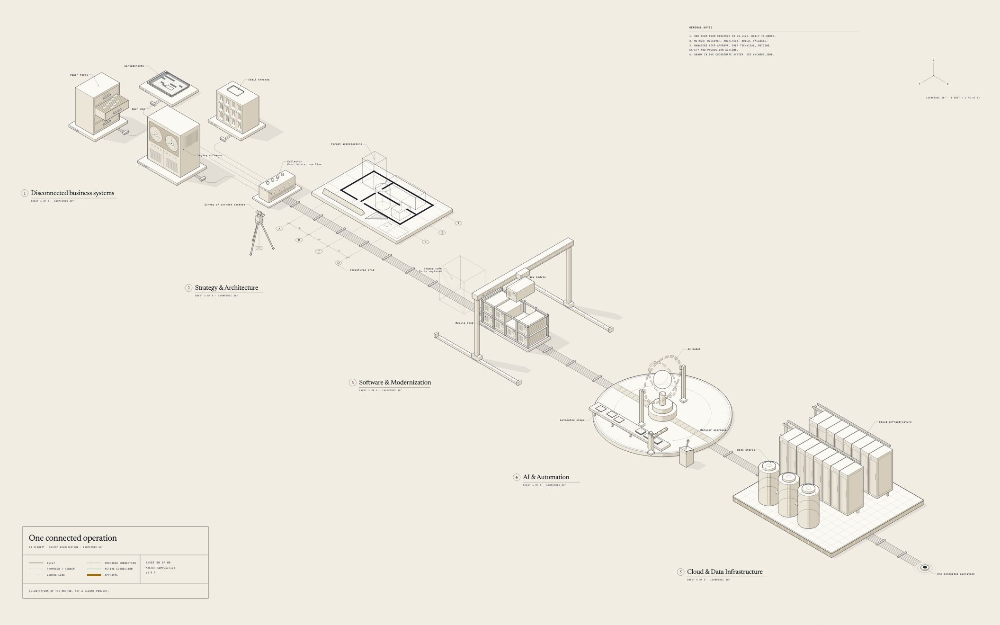
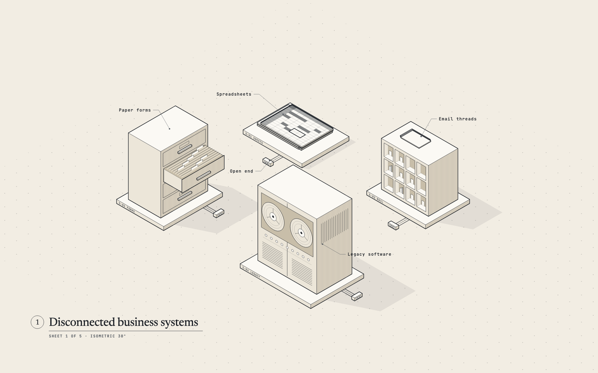
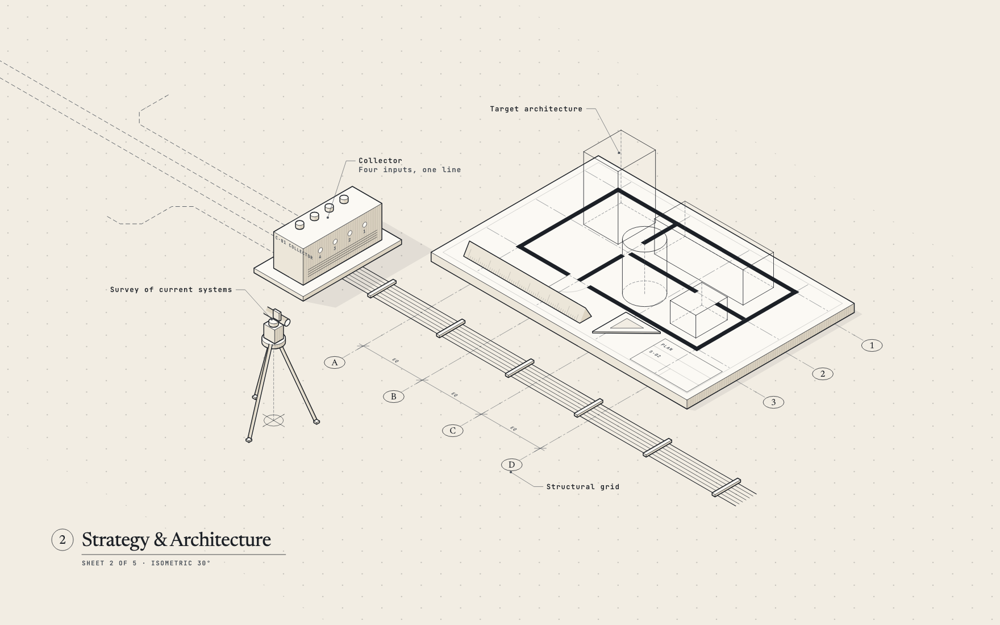
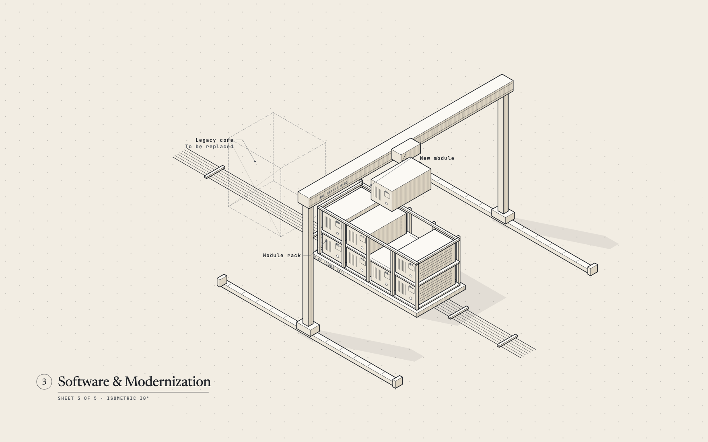
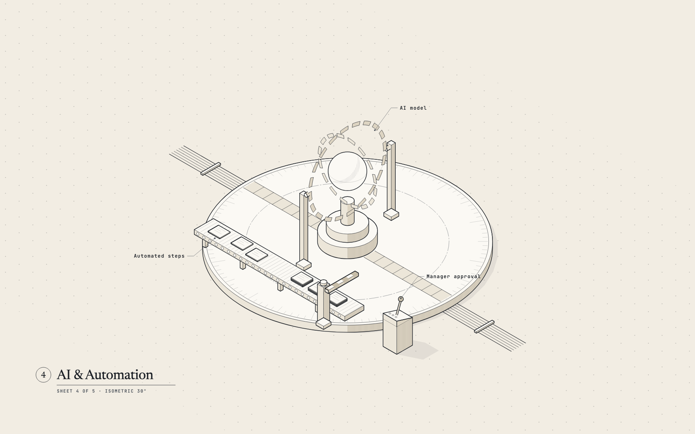
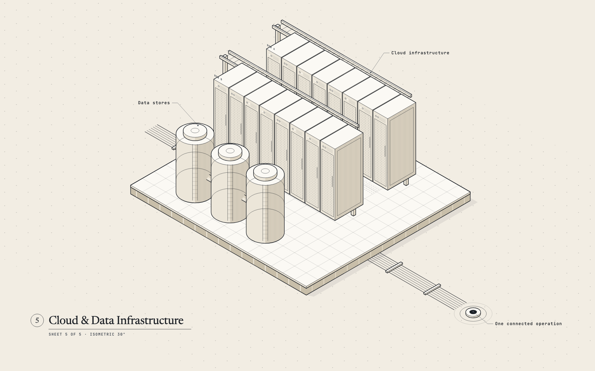
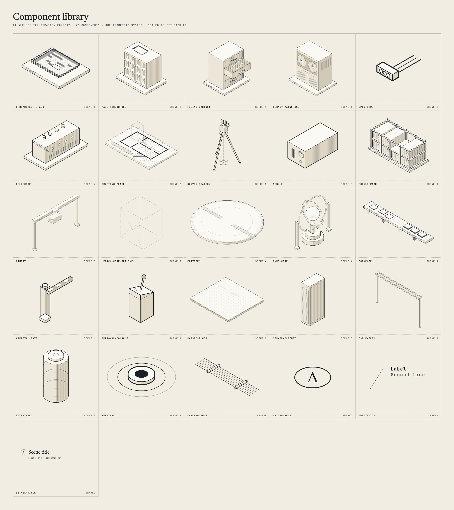

# AI Alchemy illustration foundry

One isometric engineering drawing of a business, from disconnected tools to one connected operation. It is drawn
as a single master board and cut into five scenes that the Experience Spine can reveal, pan and connect as the
visitor scrolls. The artwork contains no animation logic.



| | |
|---|---|
| **1 · Disconnected business systems**  | **2 · Strategy & Architecture**  |
| **3 · Software & Modernization**  | **4 · AI & Automation**  |
| **5 · Cloud & Data Infrastructure**  | **Component library**  |

## What is here

- `svg/master.svg`: the master composition (5280 × 3300), all scenes in one coordinate system.
- `svg/scenes/`: five scene files, same coordinates, each framed by its camera.
- `svg/components/`: 26 reusable components with ports; `components.json` lists them.
- `anchors.json`: projection, landscape and portrait cameras, and 33 connection anchors.
- `docs/SPEC.md`: **the asset interface agreed with Codex** (IDs, states, tokens, anchors, cameras).
- `docs/STYLE-GUIDE.md`: projection, grid, line weights, shading, colour roles, detail density, annotation.
- `previews/`: every render the work was checked against.

## Previews

| Set | Files |
|---|---|
| Master, overview (line weight ×2.4) | `master-paper.png`, `master-paper-active.png`, `master-night.png`, `master-night-active.png`, `master-kraft.png` |
| Master at 1:1 | `master-full-1x.png` (5280 × 3300) |
| Scenes at intended size (1760 × 1100) | `scene-N-*-paper.png`, `-paper-active`, `-night`, `-night-active` |
| Scenes at 200% | `zoom200-scene-N-*-0.png`, `-1.png` |
| Phones (4:5, notes hidden, weight ×2) | `scene-N-*-portrait.png` |
| Interface check | `check-scene-3-module-seated.png` (hanging module moved to its slot, no re-ordering) |

## Rebuild

```bash
python3 illustration/src/foundry.py
```

```bash
python3 -m http.server 8164 --bind 127.0.0.1
```

```bash
python3 illustration/src/render.py all && python3 illustration/src/render.py zoom && python3 illustration/src/render.py library
```

Python 3 standard library and Google Chrome (headless) only. Edit the generator, not the SVG output.

## Content rules

Labels use the visitor's own nouns from approved copy. The drawing states no metrics, results or client facts,
and the sheet carries the site's existing line: "Illustration of the method, not a client project."
