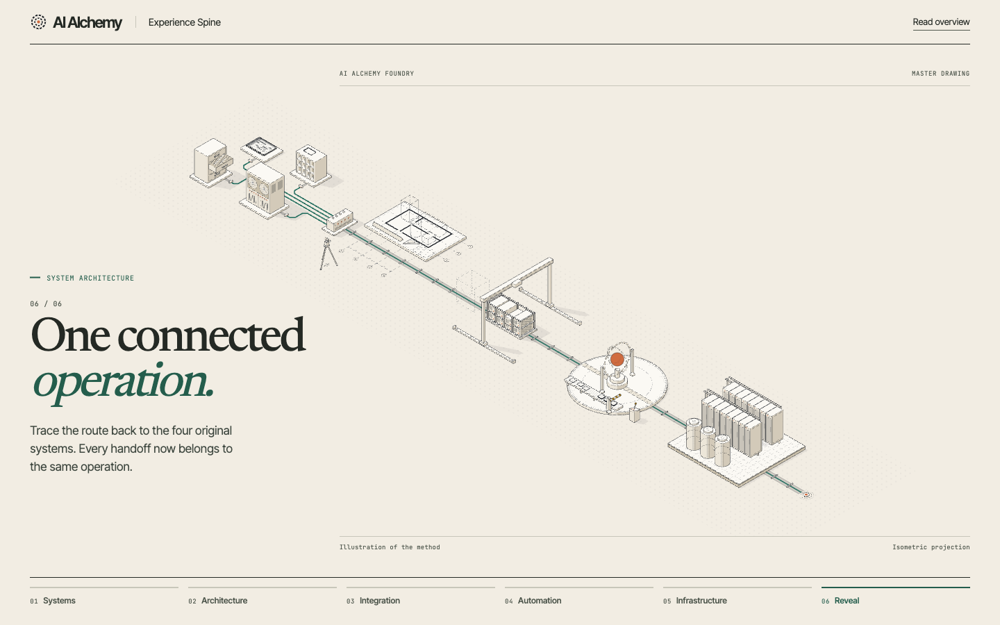

# AI Alchemy Experience Spine

An isolated, scroll-driven study of five stations on one isometric board. The last shot opens out from the terminal until the whole route fits on the sheet.

## Run the lab

From the repository root, run `python3 -m http.server 8719 --bind 127.0.0.1`, then open [the Foundry experience](http://127.0.0.1:8719/lab/experience-spine/). The page uses native ES modules, local fonts and static assets. The [geometry fixture](http://127.0.0.1:8719/lab/experience-spine/?asset=fixture) runs the same storyboard. Wheel, touch, keyboard and the six chapter links all use document scrolling. **Read overview** displays the completed system and the six explanations together.



## Review

- [Architecture and scroll storyboard](docs/architecture.md)
- [Shared SVG interface and asset integration](docs/integration.md)
- [Browser recordings, stills and motion edits](docs/review.md)
- [Performance measurements and device coverage](docs/performance.md)

## Reproduce the checks

Use Node 22 or newer. With the static server running, change into `lab/experience-spine/qa` and run:

```sh
npm ci
PLAYWRIGHT_BROWSERS_PATH="$PWD/node_modules/.browsers" npx playwright install chromium firefox webkit
npm test
npm run capture
npm run profile
(cd .. && python3 qa/report.py)
```

Use a separate profiling run after closing capture and browser tests. `SPINE_URL` can point the runners at another copy of the lab. All routes and asset URLs also work beneath a repository subpath. The QA dependencies are local to this directory.
