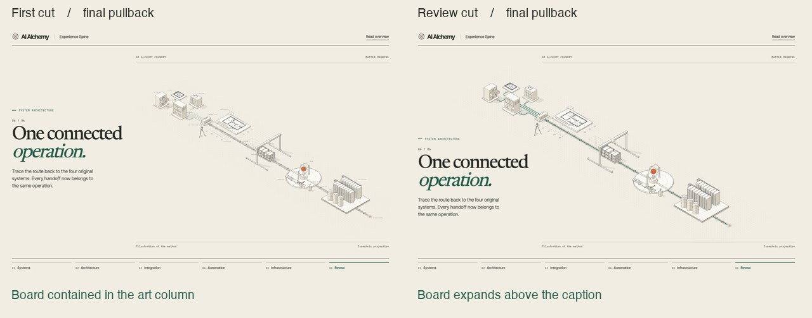

# Browser and motion review

## Watch the Foundry cut

Each recording is one continuous browser traversal. The harness moves the native document offset over eleven seconds using the page's animation clock and records the browser output. A visitor controls the duration. The forward and reverse files are independent takes. Native wheel, keyboard and touch input are exercised separately. The screenshots use exact fractions of the lab's scrollable travel.

| Layout | Recordings | Checkpoint stills |
|---|---|---|
| Desktop, 1440 × 900 | [Forward](../evidence/final/desktop/forward.webm) · [Reverse](../evidence/final/desktop/reverse.webm) | [0%](../evidence/final/desktop/0.png) · [25%](../evidence/final/desktop/25.png) · [50%](../evidence/final/desktop/50.png) · [75%](../evidence/final/desktop/75.png) · [100%](../evidence/final/desktop/100.png) |
| Tablet, 820 × 1180 | Portrait viewport stills | [0%](../evidence/final/tablet/0.png) · [25%](../evidence/final/tablet/25.png) · [50%](../evidence/final/tablet/50.png) · [75%](../evidence/final/tablet/75.png) · [100%](../evidence/final/tablet/100.png) |
| Phone, 390 × 844 | [Forward](../evidence/final/phone/forward.webm) · [Reverse](../evidence/final/phone/reverse.webm) | [0%](../evidence/final/phone/0.png) · [25%](../evidence/final/phone/25.png) · [50%](../evidence/final/phone/50.png) · [75%](../evidence/final/phone/75.png) · [100%](../evidence/final/phone/100.png) |

Check the rack front against the seated module at [46%](../evidence/final/desktop/46.png). At [84%](../evidence/final/desktop/84.png), the terminal and incoming line are isolated together immediately before withdrawal. Portrait detail frames are available for the [gantry](../evidence/final/phone/46.png) and [terminal](../evidence/final/phone/84.png).

## Edits made from the browser recordings

| First cut | Observation | Change in the review cut |
|---|---|---|
| About 3–4 s, approach to the gantry | The camera decelerated at a junction with no mechanical action to watch. | Carry center velocity through the junction. Reserve the full stop for the descent into the rack. |
| About 4–5 s, portrait rack | The rails and surrounding paper took more space than the gap between the module and its slot. | Tighten the portrait rack's protected width to 72% of the first framing. Keep the separate terminal close-up at 80%. |
| Chapter headings on the small screen | Hiding the line break joined adjacent words. | Give the headings real spaces and set their two-line composition explicitly on tall phones. |
| About 10–11 s, desktop pullback | With the full board confined to the art column, both the original tools and the active line lost their weight. | Uncover the paper above the caption as the camera widens. Keep a screen-space stroke on the active route. Move the caption lower into unused space. |
| Pausing during a handoff in installed Safari | The scroll-linked caption fade could leave an entire paragraph almost invisible for as long as the visitor stayed there. | Switch copy at the chapter boundary and keep the current text at full contrast. Camera motion continues through the handoff. |

Compare the [first desktop take](../evidence/first/desktop/forward.webm) and [first phone take](../evidence/first/phone/forward.webm) with the final recordings. The original reverse takes are preserved alongside them.

## Browser coverage

The functional suite exercised Chromium, Firefox and WebKit at all three viewport sizes. It compared camera, module and path state after reversing, refreshed at 42.4%, navigated away and back, followed a chapter link, toggled the overview, rotated the viewport, checked 320 px reflow, changed reduced motion, and loaded the geometry fixture. Every engine also received failed-asset, incompatible-version and disabled-JavaScript checks. Chromium phone testing included a synthesized touch drag through the browser input pipeline. [Run results](../evidence/browser-results.json) · [Reproduction](../qa/verify.mjs)

Installed Safari 26.6.2 on the M1 MacBook Air was inspected directly. The dotted ground and hatch patterns rendered, proposed links showed partial dashed routes, and the seated module remained behind the rack front. Page Down advanced the live camera. Increasing Safari page zoom retained readable copy alongside the art. Playwright WebKit supplied separate reproducible stills at [12%](../evidence/webkit/12.png), [46%](../evidence/webkit/46.png), and [98%](../evidence/webkit/98.png).

The initial refresh test exposed a native scroll-restoration clamp while assets were loading. Reserving the eventual scroll extent before enhancement fixed it. The static and reduced-motion readings have six real HTML articles in source order. The mounted decorative SVG is hidden from assistive technology. Physical iOS and Android devices and assistive-technology user sessions remain unverified.
